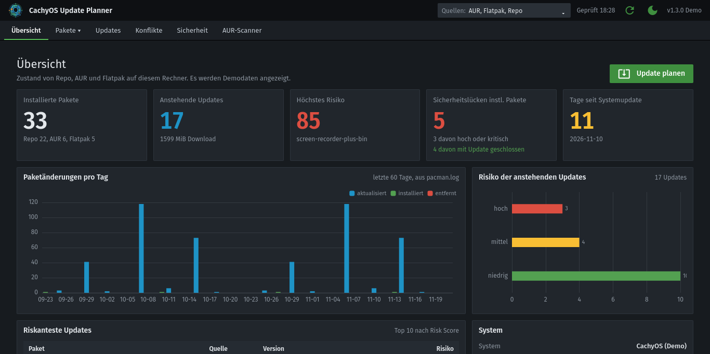

# CachyOS Update Planner

An interactive update planner for CachyOS and Arch Linux. It covers **repo packages (pacman)**, the
**AUR** and **Flatpak** in one desktop window: it rates every pending update, finds updates that only work
together, shows security advisories and news that need manual action, scans AUR build scripts for malware
patterns, and then runs the update with a progress view.


| Overview in German (follows the system language) | AUR security scanner |
|---|---|
|  |  |

## Features

- **Packages** – every installed package with its origin and a dependency graph per package; the submenu
  **Install** searches **new** packages in the CachyOS/Arch repos, the AUR and Flathub, sorted by popularity,
  with security hints, and installs them
- **Updates** – pending repo, AUR and Flatpak updates with a risk score from 0 to 100 and the reasons behind it
- **Conflicts** – updates that must be installed together (versioned dependencies, sonames, split packages),
  AUR packages that need a rebuild, Python minor bumps, expected `.pacnew` files, low disk space, a locked
  pacman database, unused Flatpak runtimes
- **Security** – installed packages listed in the Arch Linux Security Tracker, and which updates fix them
- **News** – Arch and CachyOS announcements, highlighted when they require manual intervention
- **AUR scanner** – 26 static rules for malicious patterns in `PKGBUILD` and `.install` files, a diff against
  the last built version, and checks for any AUR package *before* you install it
- **Update** – context dialog → password dialog → progress with phases, live log and questions;
  a **dry run** mode changes nothing; every run writes a log
- **Schedule** – start the update now, in 1 h, in 2 h or at a chosen time; the password is only asked for at that
  time (nothing is stored)
- **Desktop app** – own window (NiceGUI + GTK/WebKit), light and dark theme, KDE menu entry and icon
- **Language** – follows the system language (German or English; other languages fall back to English)

## Quick start

```bash
sudo pacman -S --needed pacman-contrib expac git python-gobject webkit2gtk-4.1 base-devel
git clone git@github.com:reodan78-RN/cachyos-update-planner.git
cd cachyos-update-planner
packaging/install-desktop.sh
```

Then start **CachyOS Update Planner** from the application menu, or run `update-planner`.

## Documentation

| Document | Contents |
|---|---|
| [Installation & KDE integration](docs/installation.md) | requirements, installer, menu/taskbar/autostart, updating, uninstalling, troubleshooting |
| [User guide](docs/user-guide.md) | every page, the update flow, dry run, holding packages back, AUR scanner, languages |
| [Architecture](docs/architecture.md) | modules, data sources, risk score, conflict analysis, translations |
| [Security](docs/security.md) | password handling, what runs as root, AUR builds, network access, threat model |
| [Changelog](CHANGELOG.md) | release history |

## Command line

```text
update-planner [--browser] [--port N] [--demo] [--lang de|en] [-v] [--version]
```

| Option | Effect |
|---|---|
| `--browser` | open in the web browser instead of an app window (`http://127.0.0.1:8765`) |
| `--demo` | show built-in demo data instead of the real system (includes a malicious AUR example) |
| `--lang de\|en` | force a language; default is the system language |
| `-v` | verbose logging |

## Development

```bash
python -m venv --system-site-packages .venv
.venv/bin/pip install -e '.[dev]'
.venv/bin/update-planner --browser --demo
.venv/bin/python -m pytest          # 53 tests, nothing is executed on the system
```

See [docs/architecture.md](docs/architecture.md) for the code layout.
